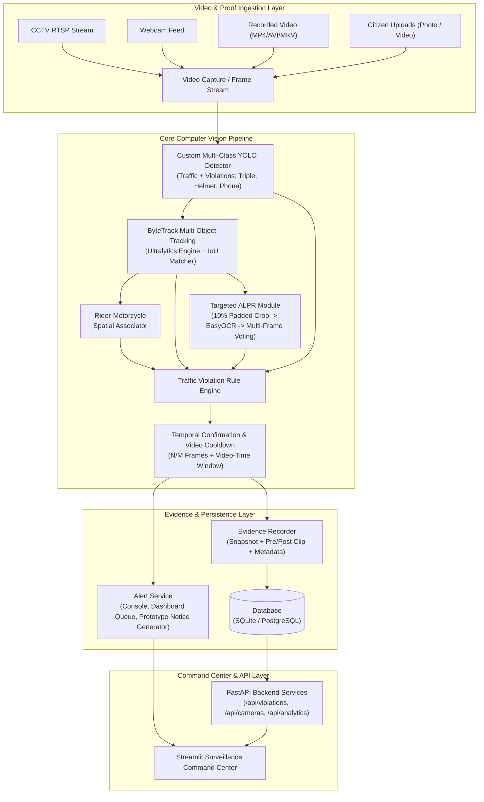

# AI-Driven Smart Traffic Violation Detection and Alert System

**B.Tech Design Project-I**  
**Lead AI Engineer & Full-Stack Developer:** Aatif Zafar  
**Deployment Profile:** Real-Time Traffic Surveillance & Violation Enforcement System (Research Prototype)

[](https://www.python.org/)
[](https://fastapi.tiangolo.com/)
[](https://streamlit.io/)
[](https://ultralytics.com/)
[](https://github.com/ifzhang/ByteTrack)
[](LICENSE)

---

## 1. Project Overview & Problem Statement

Urban traffic congestion, dangerous two-wheeler practices, signal jumping, and lane violations cause thousands of preventable road accidents daily in metropolitan cities across India (such as Bengaluru, Delhi, and Mumbai). Traditional manual enforcement by traffic police officers is physically constrained, susceptible to blind spots, and incapable of monitoring 24/7 high-density multi-lane junctions.

This project delivers a **production-structured, real-time AI computer vision system** designed to automate traffic violation monitoring from CCTV camera feeds, RTSP streams, citizen mobile proof uploads, and recorded dashcam footage. It integrates multi-object detection powered by the real-time **YOLO** architecture, persistent ByteTrack trajectory tracking, Indian High-Security Registration Plate (HSRP) recognition, temporal violation confirmation, forensic evidence archiving, and an interactive traffic command center dashboard.

---

## 2. Core Features & The 6 Project Violations

### Alliance University B.Tech Project Scope — Violation Tracking Matrix

| # | Official Project Violation | Rule Code | Detection Engine & Technique | Implementation Status |
| :-: | :--- | :--- | :--- | :-: |
| 1 | **Riding Without Helmet** | `NO_HELMET` | Fine-tuned YOLO (`WITHOUT_HELMET` vs `WITH_HELMET`) + head-crop spatial logic | **Completed** |
| 2 | **Triple Riding** | `TRIPLE_RIDING` | Direct YOLO detector (`MORE_THAN_TWO_PERSONS`, **92.3% mAP50**) + spatial cluster fallback | **Completed** |
| 3 | **Signal Jumping (Red Light)** | `RED_LIGHT_JUMP` | Dynamic virtual stop-line vector intersection during RED signal state | **Completed** |
| 4 | **Wrong-Way Driving** | `WRONG_WAY` | Trajectory centroid vector angle deviation ($> 120^\circ$) against permitted lane | **Completed** |
| 5 | **Illegal Parking / Prohibited Stopping** | `ILLEGAL_PARKING` | Stationary vehicle dwell-time tracking inside no-parking polygon zones drawn per camera ($> T$ sec, default 60 s) — `illegal_parking_rule.py` | **Completed** (needs a zone per camera) |
| 6 | **Unsafe Vehicle Movement / Rash Driving** | `UNSAFE_MOVEMENT` | Pixel-to-meter velocity estimation ($v > v_{limit}$) & weaving (zig-zag) trajectory detection — `unsafe_movement_rule.py` | **Completed** (speed needs pixels-per-metre per camera) |
| 7 | **Driving Without Seatbelt** | `NO_SEATBELT` | Two-stage windshield ROI crop + fine-tuned YOLO detector + multi-frame voting | **Completed (Experimental)** |
| + | **Driver Mobile Phone Usage** | `MOBILE_PHONE_WHILE_DRIVING` | Direct visual detection using fine-tuned `USING_MOBILE` class (**71.5% mAP50**) | **Completed** |

---

### Detailed Violation Specifications

1. **Triple Riding (`TRIPLE_RIDING`):**
   - **Direct Deep Learning Detection:** Trained directly on the `MORE_THAN_TWO_PERSONS` visual class achieving **92.3% mAP50** (85.6% precision, 86.4% recall) on 6,057 annotated instances.
   - **Dual-Engine Architecture:** Detects triple riding either directly via the fine-tuned custom YOLO model or through geometric spatial rider-motorcycle clustering heuristics (`rider_count > 2`).
2. **Riding Without Helmet (`NO_HELMET`):**
   - Evaluated by the unified custom detector (`WITHOUT_HELMET` vs `WITH_HELMET` classes).
   - Driven by [`models/traffic_custom.pt`](models/traffic_custom.pt) with spatial association to tracked two-wheelers.
3. **Mobile Phone Use While Riding/Driving (`MOBILE_PHONE_WHILE_DRIVING`):**
   - Direct visual detection using the custom-trained `USING_MOBILE` class (**71.5% mAP50**).
4. **Red-Light Jumping (`RED_LIGHT_JUMP`):**
   - Dynamically configurable virtual stop-line vectors.
   - Intersection vector crossing detected while traffic signal phase is `RED` (supports manual phase or `AUTO` optical lamp inspection).
5. **Wrong-Way Driving (`WRONG_WAY`):**
   - Vehicle centroid trajectory vector smoothing across sliding windows.
   - Angular deviation calculation ($> 120^\circ$) against permitted lane vectors.
6. **Citizen Proof AI Ingestion (Photo & Video):**
   - Citizens can upload videos or smartphone photos on the *Upload proof* tab.
   - Photos and videos automatically pass through the custom AI model with auto-calibrated confidence thresholds and bounding box visualization.

### Key Capabilities
- **Temporal Confirmation:** Multi-frame confirmation ($N$ out of $M$ sliding frames) prevents single-frame false alarms.
- **Video Time Cooldown:** Video-synchronized cooldown ($frame\_idx / fps$) throttles duplicate penalty generation for the same vehicle track.
- **Indian HSRP ALPR:** Regex-based validation (`^[A-Z]{2}[0-9]{1,2}[A-Z]{0,3}[0-9]{4}$`), character ambiguity resolution (`0/O`, `8/B`, `1/I`), and multi-frame consensus voting.
- **Traceable Forensic Evidence:** Generates an incident folder with high-res snapshot (`violation_frame.jpg`), pre/post video clip (`evidence.mp4`), and audit payload (`metadata.json`).
- **Officer Review Workflow:** Every detection is saved as *Waiting for review*. Only an officer's approval creates a prototype notice (`PROTO-`). Rejections log their reason as training data.
- **Duplicate Merging:** The same plate (or tracked vehicle) with the same violation within `dedup_window_seconds` merges into one incident record with an incremented count.
- **Per-Camera Calibration:** Stop line, lane direction, signal-light area and rule switches are configured on the dashboard's Camera setup page and saved to `data/camera_calibration.yaml`.

---

## 3. System Architecture



---

### Folder Structure

```
trafficdetection/
├── algorithms/            AI and computer-vision logic
│   ├── detection/         YOLO object detection & custom model runner  → detector.py
│   ├── tracking/          ByteTrack / DeepSORT tracking                → byte_tracker.py
│   ├── association/       rider ↔ motorcycle spatial linking           → rider_association.py
│   ├── plate_ocr/         EasyOCR Indian license plate reader          → plate_recognizer.py
│   ├── violation_rules/   helmet, triple riding, red light, wrong way   → triple_riding_rule.py ...
│   └── calibration/       camera stop line, lane direction & signal   → camera_calibration.py
├── pipeline/              frame-by-frame master orchestrator           → traffic_pipeline.py
├── models/                trained weights (traffic_custom.pt, yolo26n.pt, yolov8n.pt)
├── training/              dataset builder and Colab GPU training scripts
│   ├── train_triple_riding_colab.ipynb  → Google Colab T4 GPU notebook for 5-class model
│   ├── train_colab.ipynb                → base multi-model training notebook
│   └── build_dataset.py                 → dataset merging & deduplication pipeline
├── evaluation/            benchmarks, scenario generators & model comparisons
├── datasets/              raw datasets (05_triple_riding with 6,057 images & labels)
├── backend/               FastAPI server & services
│   ├── api/               REST endpoints (/api/violations, /api/cameras ...)
│   ├── db_models/         SQLAlchemy ORM models
│   ├── services/          review workflow, citizen uploads, alert generator
│   └── database/          SQLite (traffic_system.db) & PostgreSQL engine
├── dashboard/             Streamlit surveillance command center (app.py, ui.py, views/)
├── scripts/               run_video.py, seed_demo_data.py, clean_test_data.py
├── tests/                 automated pytest unit & integration test suite
└── config.yaml            application parameters, thresholds, and camera definitions
```

---

## 4. Trained Custom Model Metrics

### 4.1 Multi-Violation Model (models/traffic_custom.pt)

The custom violation model (`models/traffic_custom.pt`) was trained on **Google Colab (Tesla T4 GPU)** using a curated dataset of **6,057 images** (`kashish/3riders v2`):

| Class | Precision ($P$) | Recall ($R$) | $\text{mAP}_{50}$ | $\text{mAP}_{50-95}$ | Primary Violation Mapped |
| :--- | :---: | :---: | :---: | :---: | :--- |
| **`MORE_THAN_TWO_PERSONS`** | **85.6%** | **86.4%** | **92.3%** | 53.8% | **Triple Riding** |
| **`WITH_HELMET`** | **84.0%** | **75.7%** | **83.5%** | 46.6% | Helmet Compliance |
| **`USING_MOBILE`** | **77.0%** | **63.1%** | **71.5%** | 37.7% | Mobile Phone Use |
| **`WITHOUT_HELMET`** | **64.9%** | **55.7%** | **61.8%** | 32.0% | **No Helmet Violation** |
| **`normal`** | **82.9%** | **63.6%** | **67.5%** | 31.6% | Standard Riding |
| **All Classes (Mean)** | **78.9%** | **68.9%** | **75.3%** | **40.4%** | — |

- **Inference Speed:** **3.9 ms** per frame on GPU (~256 FPS), **~52 ms** on local CPU (~19 FPS).
- **Model Size:** 73 layers, 3.13M parameters, 8.6 GFLOPs.

### 4.2 Seatbelt Violation Model (models/seatbelt_best.pt)

The seatbelt detector is a custom-trained **YOLO26n** architecture trained on Google Colab (Tesla T4 GPU) across aggregated research datasets.

**Official Held-Out Test Split Evaluation Metrics:**

| Class / Category | Precision ($) | Recall ($) | $\text{mAP}_{50}$ | $\text{mAP}_{50-95}$ | Primary Violation Mapped |
| :--- | :---: | :---: | :---: | :---: | :--- |
| **seatbelt** (Class 0) | **0.865** | **0.679** | **0.732** | 0.362 | Compliant Seatbelt Fastened |
| **
o_seatbelt** (Class 1) | **0.798** | **0.432** | **0.459** | 0.210 | **No Seatbelt Violation** (NO_SEATBELT) |
| **All Classes (Mean)** | **0.832** | **0.556** | **0.595** | **0.286** | Unified Test Benchmark |

- **Model Artifact:** models/seatbelt_best.pt (5.45 MB, 140 layers, 2.39M parameters).
- **Inference Latency:** **~4.8 ms** per ROI crop on GPU, **~42 ms** on local CPU.
- **Architectural Safeguards:** High precision (83.2% overall, 79.8% on violation class) ensures that generated violations have high fidelity. Lower recall (43.2% on 
o_seatbelt) under difficult optical conditions is intentionally addressed by requiring clear windshield visibility (Laplacian sharpness $\ge 30.0$, crop size $\ge 90\times 90$ px) and multi-frame temporal voting (6 of 10 sliding frames) before raising a violation. Every detection is routed to the Officer Review Console for human validation.

---

## 5. Technology Stack

| Domain | Technology / Library | Role |
| :--- | :--- | :--- |
| **Language** | Python 3.11+ / 3.13 | Core runtime environment |
| **Deep Learning** | PyTorch & Ultralytics YOLO (`traffic_custom.pt`, `yolo26n.pt`) | Real-time violation & vehicle object detection |
| **Multi-Object Tracking** | ByteTrack (Ultralytics engine + lap) | Persistent vehicle & rider tracking IDs |
| **ALPR & OCR** | EasyOCR, OpenCV, Regex | Indian plate recognition & multi-frame consensus |
| **Backend API** | FastAPI, Uvicorn, Pydantic v2 | Async REST services & video stream ingestion |
| **Database & ORM** | SQLAlchemy ORM, SQLite (`traffic_system.db`) / PostgreSQL | Relational persistence & event history |
| **Command Center** | Streamlit, Plotly, HTML5/CSS3 | Traffic monitoring dashboard & analytics |
| **Evidence Storage** | OpenCV VideoWriter, JSON | Forensic snapshots, video clips, and audit trails |

---

## 6. Installation & Quickstart

### 1. Clone & Set Up Environment

#### Windows (PowerShell) Setup
```powershell
# 1. Clone repository
git clone https://github.com/aatifzafar/trafficdetection.git
cd trafficdetection

# 2. Allow local script execution (if virtualenv activation is restricted)
Set-ExecutionPolicy -Scope Process -ExecutionPolicy Bypass

# 3. Create virtual environment
python -m venv .venv

# 4. Activate virtual environment
.venv\Scripts\Activate.ps1

# 5. Upgrade pip and install dependencies
python -m pip install --upgrade pip
pip install -r requirements.txt

# (Optional) For NVIDIA GPU CUDA acceleration:
# pip install torch torchvision --index-url https://download.pytorch.org/whl/cu124
```

#### Linux / macOS Setup
```bash
git clone https://github.com/aatifzafar/trafficdetection.git
cd trafficdetection

python3 -m venv .venv
source .venv/bin/activate

python -m pip install --upgrade pip
pip install -r requirements.txt
```

### 2. Environment Variables
Copy the `.env.example` file (defaults to zero-config SQLite):
```bash
cp .env.example .env
```

---

## 7. Running the System

### Option A: Launch Streamlit Command Center (Recommended)
```bash
streamlit run dashboard/app.py
```
Open **`http://localhost:8501`** in your browser.
- **Pages Available:** Overview · Review queue · Live cameras · Upload proof · Violations · Vehicles · Analytics · Models · Evaluation · Camera setup · Settings.
- **Review Queue:** Review pending violations, inspect forensic snapshots with AI bounding boxes, approve to generate prototype notices, or reject false positives.
- **Upload Proof:** Upload photos or recorded video clips to run immediate AI violation analysis.

### Option B: Launch FastAPI Backend Server
```bash
uvicorn backend.main:app --host 127.0.0.1 --port 8000 --reload
```
Interactive Swagger API documentation: **`http://127.0.0.1:8000/docs`**.

### Option C: Run Pipeline on Video (CLI)
```bash
python scripts/run_video.py --video data/videos/22.mp4 --signal AUTO --save-screenshots 3
```

### Option D: Run Unit Tests
```bash
python -m pytest tests
```
All 31 automated test suites execute against an isolated test database.

### Option E: Seatbelt Violation Detection (Training, Evaluation & Testing)

1. **Build Unified Dataset:**
   ```bash
   python scripts/build_seatbelt_dataset.py
   ```
   Deduplicates 3 public research sources, enforces strict perceptual dHash zero cross-split leakage, and outputs `data/seatbelt/data.yaml`.

2. **Train Model:**
   - **Local GPU:**
     ```bash
     python scripts/train_seatbelt.py --epochs 50 --batch 16 --imgsz 640
     ```
   - **Free Google Colab T4 GPU:**
     Open `notebooks/train_seatbelt_colab.ipynb` in Google Colab, upload `data/seatbelt_dataset.zip`, run all cells with 1 click, and download `seatbelt_best.pt` into `models/`.

3. **Evaluate on Validation & Held-Out Test Splits:**
   ```bash
   python scripts/evaluate_seatbelt.py --model models/seatbelt_best.pt
   ```
   Writes precision, recall, mAP50, and limitations dossier to `data/evaluation_results_seatbelt.json`.

4. **Launch Seatbelt AI Lab Dashboard:**
   ```bash
   streamlit run dashboard/app.py
   ```
   Navigate to the **Seatbelt Lab** page to upload single images or a ZIP archive (up to 3,000 images) or browse the curated held-out test samples (`data/seatbelt/test_samples/`), inspect color-coded bounding boxes, filter by violations, and download audit CSVs.

5. **FastAPI Endpoints:**
   - `POST /api/seatbelt/detect`: Upload windshield image for inference.
   - `GET /api/seatbelt/metrics`: Retrieve measured precision, recall, and CCTV operational limitations.

---

## 8. Developer Guide: How to Add a New Traffic Violation Detection (Extensibility Blueprint)

The system is built on a modular, decoupled architecture where AI vision, tracking, violation rules, evidence archiving, and officer review communicate through standardized contracts.

If you (or another teammate, researcher, or contributor) want to implement a new violation detection (such as **`ILLEGAL_PARKING`**, **`UNSAFE_MOVEMENT`**, **`RECKLESS_OVERTAKING`**, or **`SEATBELT`**), follow this step-by-step checklist. Following these 6 steps guarantees that the new violation will automatically work across all CLI runners, live video streams, evidence recorders, database tables, and the Streamlit review dashboard.

---

### Step-by-Step Architecture Checklist

| Step | Layer | File to Create / Modify | Purpose |
| :---: | :--- | :--- | :--- |
| **1** | **Legal Schedule** | `backend/services/challan_service.py` | Add Motor Vehicles Act section, legal title, fine amount (₹), and penalty demerit points. |
| **2** | **Rule Implementation** | `algorithms/violation_rules/<rule_name>_rule.py` | Inherit from `BaseViolationRule`, write detection/spatial math in `evaluate(context)`, and apply temporal confirmation. |
| **3** | **Rule Engine & Config** | `algorithms/violation_rules/rule_engine.py` & `config.yaml` | Instantiate the rule, read calibration thresholds, and add toggle switch in configuration. |
| **4** | **Pipeline & HUD** | `pipeline/traffic_pipeline.py` | Route class names (ByteTrack vs Evidence) and define bounding box overlay color in `_render_annotations`. |
| **5** | **Review Queue & Citizen AI** | `dashboard/views/review.py` & `backend/services/citizen_service.py` | Add category filter, human-readable explainability dossier (`_why`), and photo upload detector mapping. |
| **6** | **Unit & Regression Tests** | `tests/test_violations.py` | Write automated temporal confirmation tests and run `pytest`. |

---

### Detailed Implementation Guide

#### Step 1: Define Penal Schedule (`backend/services/challan_service.py`)
Add your new violation to `PENAL_CODE_SCHEDULE` with official Motor Vehicles (Amendment) Act details:
```python
PENAL_CODE_SCHEDULE = {
    # ... existing violations ...
    "ILLEGAL_PARKING": {
        "section": "Section 122 & 177, Motor Vehicles Act",
        "description": "Abandoning or leaving motor vehicle in a prohibited / restricted no-parking zone",
        "fine_inr": 1000,
        "points": 2,
    },
}
```

#### Step 2: Implement the Rule (`algorithms/violation_rules/<rule_name>_rule.py`)
Create a new rule class inheriting from `BaseViolationRule`.
- Use `self.record_frame_evidence(track_id, is_violating, current_time=current_time)` to eliminate single-frame false flickers and enforce video-time cooldowns.
- Context dictionary contains: `frame`, `frame_idx`, `fps`, `detections`, `tracked_objects`, `tracked_vehicles`, `motorcycle_groups`, `detector`, `traffic_signal_state`.

```python
import time
from typing import Dict, Any, List
from algorithms.violation_rules.base_rule import BaseViolationRule

class IllegalParkingRule(BaseViolationRule):
    def __init__(
        self,
        parking_polygon: List[List[float]] = None,
        max_dwell_seconds: float = 30.0,
        temporal_window: int = 10,
        min_positive_frames: int = 4,
        cooldown_seconds: float = 20.0,
    ):
        super().__init__(
            rule_name="ILLEGAL_PARKING",
            temporal_window=temporal_window,
            min_positive_frames=min_positive_frames,
            cooldown_seconds=cooldown_seconds,
        )
        self.parking_polygon = parking_polygon or []
        self.max_dwell_seconds = max_dwell_seconds
        self.vehicle_dwell_start: Dict[int, float] = {}

    def evaluate(self, context: Dict[str, Any]) -> List[Dict[str, Any]]:
        tracked_vehicles = context.get("tracked_vehicles", [])
        frame_idx = context.get("frame_idx", 0)
        fps = context.get("fps", 25.0) or 25.0
        current_time = (frame_idx / fps) if frame_idx > 0 else time.time()
        violations = []

        for v in tracked_vehicles:
            cx, cy = (v.bbox[0] + v.bbox[2]) / 2.0, (v.bbox[1] + v.bbox[3]) / 2.0
            
            # Check if vehicle is stationary inside restricted polygon
            is_inside_restricted_zone = self._point_in_poly(cx, cy, self.parking_polygon)
            is_stopped = getattr(v, "speed", 0.0) < 1.0  # Stationary check

            is_violating = False
            if is_inside_restricted_zone and is_stopped:
                dwell_start = self.vehicle_dwell_start.setdefault(v.track_id, current_time)
                if (current_time - dwell_start) >= self.max_dwell_seconds:
                    is_violating = True
            else:
                self.vehicle_dwell_start.pop(v.track_id, None)

            # Record temporal evidence sliding window
            if self.record_frame_evidence(v.track_id, is_violating, current_time=current_time):
                violations.append({
                    "violation_type": "ILLEGAL_PARKING",
                    "track_id": v.track_id,
                    "confidence": 0.92,
                    "timestamp": time.time(),
                    "evidence_required": True,
                    "extra": {
                        "dwell_time_seconds": round(current_time - self.vehicle_dwell_start.get(v.track_id, current_time), 1),
                        "zone_name": "No Parking Yellow Zone",
                    },
                })
        return violations
```

#### Step 3: Register Rule in Engine & Config
1. In `algorithms/violation_rules/rule_engine.py`:
   - Import `IllegalParkingRule`.
   - In `TrafficRuleEngine.__init__`, check `if v_cfg.get("illegal_parking", True):` and instantiate the rule into `self.rules["illegal_parking"]`.
2. In `config.yaml`:
   ```yaml
   violations:
     helmet: true
     triple_riding: true
     red_light: true
     wrong_way: true
     illegal_parking: true    # Enable new rule
     unsafe_movement: false
   ```

#### Step 4: Route Bounding Boxes and HUD (`pipeline/traffic_pipeline.py`)
1. **Tracking Routing:**
   - If the new violation is an **object/vehicle to track** (e.g. car, bus, motorcycle), ensure its class is passed to `ByteTrack`.
   - If it is a **visual evidence attribute** (e.g., `MORE_THAN_TWO_PERSONS`, `SEATBELT`, `USING_MOBILE`), ensure its name is in `CUSTOM_CLASSES` so ByteTrack routes it to the rule engine without disrupting vehicle tracking.
2. **HUD Visualization (`_render_annotations`):**
   - Add custom badge text and bounding box color in `_render_annotations`:
     ```python
     elif cname == "ILLEGAL_PARKING":
         badge_text = f"ILLEGAL PARKING {int(d.confidence * 100)}%"
         badge_color = (0, 0, 255)  # Bright Red
     ```

#### Step 5: Dashboard Review & Citizen Uploads
1. **Explainability in Review Dossier (`dashboard/views/review.py`):**
   - Add title in `TITLES`: `"ILLEGAL_PARKING": "Prohibited Parking / Restricted Zone Obstruction"`
   - Add filter in `FILTERS`: `"Illegal parking": "ILLEGAL_PARKING"`
   - Add explanation in `_why`:
     ```python
     elif t == "ILLEGAL_PARKING":
         dwell = extra.get("dwell_time_seconds", 30)
         lines.append(f"Dwell Tracking: Vehicle stationary in restricted zone for {dwell}s (limit: 30s)")
     ```
2. **Citizen Photo Upload Support (`backend/services/citizen_service.py`):**
   - In `process_upload`, map the detector class name to your violation name so citizen photo uploads automatically detect it:
     ```python
     elif cname in {"ILLEGAL_PARKING", "NO_PARKING"}:
         viol_name = "ILLEGAL_PARKING"
     ```

#### Step 6: Automated Unit Test (`tests/test_violations.py`)
Add a deterministic unit test validating temporal confirmation and cooldown:
```python
def test_illegal_parking_rule_temporal_confirmation():
    rule = IllegalParkingRule(temporal_window=5, min_positive_frames=3, cooldown_seconds=5.0)
    # Simulate stationary vehicle in restricted zone across frames 1, 2, 3...
    # assert len(rule.evaluate(context)) == 1 on frame 3
```
Run tests:
```bash
python -m pytest tests
```

---

## 9. Training Your Own Custom Model

A dedicated Google Colab notebook is provided in the repository:
👉 [`training/train_triple_riding_colab.ipynb`](training/train_triple_riding_colab.ipynb)

1. Open [Google Colab](https://colab.research.google.com) and upload `training/train_triple_riding_colab.ipynb`.
2. Connect to a free **T4 GPU** runtime (`Runtime -> Change runtime type -> T4 GPU`).
3. Click **Run all** (`Ctrl + F9`). The notebook automatically pulls the 6,057-image dataset via Roboflow API, trains YOLO for 30 epochs, evaluates on the test split, displays the confusion matrix, and downloads `best.pt`.
4. Copy the downloaded `best.pt` into `models/traffic_custom.pt`.

---

## 10. API Endpoint Documentation

| Method | Endpoint | Description |
| :--- | :--- | :--- |
| `GET` | `/health` | System health check and runtime device status |
| `GET` | `/api/cameras` | List all configured camera feeds |
| `POST` | `/api/cameras` | Register a new camera or RTSP endpoint |
| `POST` | `/api/cameras/{id}/start` | Start stream ingestion for camera |
| `POST` | `/api/cameras/{id}/stop` | Stop stream ingestion for camera |
| `POST` | `/api/upload-video` | Upload video file and launch pipeline |
| `GET` | `/api/violations` | Searchable & filterable violation list |
| `GET` | `/api/violations/{id}` | Detailed incident record |
| `GET` | `/api/violations/{id}/evidence` | Forensic snapshots, video clips, and metadata |
| `GET` | `/api/vehicles/{plate_number}` | Vehicle history ledger by registration number |
| `GET` | `/api/analytics/summary` | Command center KPI metrics |
| `GET` | `/api/analytics/by-type` | Violations aggregated by category |
| `GET` | `/api/analytics/by-hour` | Hourly distribution profile |
| `GET` | `/api/analytics/hotspots` | Spatial violation cluster coordinates |
| `GET` | `/api/alerts/live` | Real-time incident alert feed |

---

## 11. Research Context & Indian Driving Datasets

This system is architected for the unstructured dynamics of Indian traffic scenes:
- **DashCop (WACV 2025):** E-ticket two-wheeler violation enforcement and rider-motorcycle spatial associations.
- **Goyal et al. (CVPRW 2022):** Motorcycle rider violations on unconstrained Indian roads.
- **India Driving Dataset (IDD, WACV 2019):** Bangalore & Hyderabad roadway navigation, autorickshaws, and dense mixed-traffic density.
- **UFPR-ALPR:** Multi-frame voting and regex validation for high-accuracy license plate character resolution.

---

## 12. Project Roadmap & Upcoming TODO List

The following tasks represent the active development roadmap toward the final project review:

### Next Milestone TODOs (Remaining Violations & Features)

- [ ] **TODO 1: Implement Illegal Parking Detection Rule (`ILLEGAL_PARKING`)**
  - Add virtual "No-Parking / Yellow Box" polygon calibration zone to `algorithms/calibration/camera_calibration.py`.
  - Create `algorithms/violation_rules/illegal_parking_rule.py` tracking stationary vehicle tracks ($v \approx 0$) inside the polygon exceeding threshold dwell-time ($T > 30\text{ s}$).
  - Register rule into `rule_engine.py` and dashboard camera calibration interface.

- [ ] **TODO 2: Implement Unsafe Movement / Speed Estimation Rule (`UNSAFE_MOVEMENT`)**
  - Implement 4-point homography transformation (Bird's Eye View) for distance calibration (pixels $\rightarrow$ meters).
  - Calculate vehicle velocity across sliding frame windows: $v = \frac{\Delta d}{\Delta t} \times 3.6\text{ km/h}$.
  - Flag vehicles exceeding calibrated junction speed limits ($> 60\text{ km/h}$) or exhibiting erratic zigzag trajectory deviations.

- [ ] **TODO 3: Automated Traffic Signal Light Classifier**
  - Train lightweight classifier on `datasets/raw/03_traffic_light_state/` (1,488 images) to dynamically detect junction signal states (RED / YELLOW / GREEN) without manual toggles.

- [ ] **TODO 4: Formal Prototype Notice PDF Export**
  - Implement automated printable e-challan PDF generation (with QR verification code, junction map, vehicle photo, and fine breakdown under Motor Vehicles Act) upon officer approval in the Review queue.

- [ ] **TODO 5: Multi-Camera Concurrent RTSP Grid**
  - Stress-test concurrent stream ingestion for 4 simultaneous live CCTV camera feeds on the dashboard.

---

## 13. Known Limitations & Future Scope

### Current Limitations
- **Night & Rain Conditions:** Reduced detection confidence under heavy headlight glare or nighttime low-light conditions.
- **Oblique Angles:** Highly acute angles may occlude helmets or plate characters, relying on temporal tracking voting.
- **Camera Calibration:** Stop-lines, lane direction vectors, and signal areas are calibrated per fixed camera junction.
- **Seatbelt Optical Challenges:**
  - Heavily tinted windshields, interior cabin shadow, and oblique angle perspectives reduce visual contrast of seatbelt webbing.
  - Mitigated via our two-stage perspective engine, optical gatekeepers (Laplacian sharpness $\ge 30.0$, crop size $\ge 90\times 90$ px), 6-of-10 sliding frame temporal voting, and mandatory Officer Review queue verification before fine issuance.

### Future Scope
- Automated perspective vanishing-point and stop-line calibration.
- Edge deployment optimization on NVIDIA Jetson Orin / Coral Edge TPU via TensorRT FP16 quantization.
- Direct integration with smart city Integrated Traffic Management Systems (ITMS).
- Speed estimation using homography-calibrated bird's-eye-view transformations.

---

## 14. Hosting Locally & Sharing with Friends / Evaluators

The system can be hosted locally on your machine and shared with friends, professors, or team members anywhere in the world without requiring port forwarding or router access.

### 🌐 Instant Public Share Link (Cloudflare Tunnel)
The project includes a pre-configured, zero-setup Cloudflare Tunnel runner:
```powershell
# Double-click or run:
.\start_share_link.bat
```
This automatically boots:
1. **FastAPI Backend Service:** `http://127.0.0.1:8000`
2. **Streamlit Interactive UI:** `http://localhost:8501`
3. **Public Secure HTTPS Tunnel:** Provides a direct `https://<unique-subdomain>.trycloudflare.com` link.

Anyone clicking the public HTTPS link on their mobile device or PC can:
- Test Citizen Photo uploads with auto AI multi-violation detection.
- Monitor live CCTV surveillance feeds (Triple Riding & Helmet detection).
- Audit and approve/reject violation dossiers in the Officer Review Console.

---

## 15. License
Licensed under the [MIT License](LICENSE).
