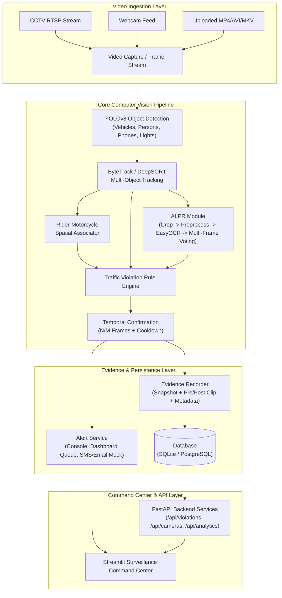

# AI-Driven Smart Traffic Violation Detection and Alert System

**B.Tech Design Project-I**  
**Lead AI Engineer & Full-Stack Developer:** Aatif Zafar  
**Deployment Profile:** Real-Time Traffic Surveillance & Violation Enforcement System (Research Prototype)

[](https://www.python.org/)
[](https://fastapi.tiangolo.com/)
[](https://streamlit.io/)
[](https://ultralytics.com/)
[](https://github.com/ifzhang/ByteTrack)
[](LICENSE)

---

## 1. Project Overview & Problem Statement

Urban traffic congestion, dangerous two-wheeler practices, signal jumping, and lane violations cause thousands of preventable road accidents daily in metropolitan cities across India (such as Bengaluru, Delhi, and Mumbai). Traditional manual enforcement by traffic police officers is physically constrained, susceptible to blind spots, and incapable of monitoring 24/7 high-density multi-lane junctions.

This project delivers a **production-structured, real-time AI computer vision system** designed to automate traffic violation monitoring from CCTV camera feeds, RTSP streams, and recorded dashcam footage. It integrates multi-object detection, persistent trajectory tracking, spatial rider-to-motorcycle association, Indian High-Security Registration Plate (HSRP) recognition, temporal violation confirmation, forensic evidence archiving, and an interactive traffic command center dashboard.

---

## 2. Core Features & Supported Violations

### Primary Violation Rules
1. **Riding Without Helmet (`NO_HELMET`):**
   - Head-crop analysis of rider and pillion passengers.
   - Evaluated via custom classifier or spatial baseline texture analysis.
   - Associated directly with motorcycle track entity.
2. **Triple Riding (`TRIPLE_RIDING`):**
   - Spatial association clusters multiple riders atop a single motorcycle.
   - Flags incidents when `rider_count > 2`.
3. **Red-Light Jumping (`RED_LIGHT_JUMP`):**
   - Dynamically configurable virtual stop-line vectors.
   - Intersection vector crossing detected while traffic signal phase is `RED`.
4. **Wrong-Way Driving (`WRONG_WAY`):**
   - Vehicle centroid trajectory vector smoothing across sliding windows.
   - Angular deviation calculation ($> 120^\circ$) against permitted lane vectors.
5. **Driving Without Seatbelt (`NO_SEATBELT`):**
   - Four-wheeler windshield region extraction.
   - Graceful standby mode reporting *"Seatbelt detection model not configured"* when custom weights are absent, avoiding synthetic detections.
6. **Mobile-Phone Use While Driving (`MOBILE_PHONE_WHILE_DRIVING`):**
   - Driver/rider bounding box correlation with detected cell phones.

### Key Capabilities
- **Temporal Confirmation:** Multi-frame confirmation ($N$ out of $M$ sliding frames) prevents single-frame false alarms.
- **Cooldown Throttling:** 10-second cooldown suppresses duplicate penalty generation for the same vehicle.
- **Indian HSRP ALPR:** Regex-based validation (`^[A-Z]{2}[0-9]{1,2}[A-Z]{0,3}[0-9]{4}$`), character ambiguity resolution (`0/O`, `8/B`, `1/I`), and multi-frame consensus voting.
- **Traceable Forensic Evidence:** Generates an incident folder with high-res snapshot (`violation_frame.jpg`), pre/post video clip (`evidence.mp4`), and audit payload (`metadata.json`).

---

## 3. System Architecture



---

## 4. Technology Stack

| Domain | Technology / Library | Role |
| :--- | :--- | :--- |
| **Language** | Python 3.11+ / 3.13 | Core runtime |
| **Deep Learning** | PyTorch & Ultralytics YOLOv8 / YOLO11 | Real-time object detection |
| **Multi-Object Tracking** | ByteTrack / DeepSORT | Persistent vehicle & rider tracking IDs |
| **ALPR & OCR** | EasyOCR, OpenCV, Regex | Indian plate recognition & multi-frame voting |
| **Backend API** | FastAPI, Uvicorn, Pydantic v2 | Async REST services & video ingestion |
| **Database & ORM** | SQLAlchemy ORM, SQLite / PostgreSQL | Structured persistence & event history |
| **Command Center** | Streamlit, Plotly, HTML5/CSS3 | Traffic monitoring dashboard & analytics |
| **Evidence Storage** | OpenCV VideoWriter, JSON | Forensic video clips and audit trails |

---

## 5. Installation & Environment Setup

### 1. Clone & Navigate to Repository
```bash
git clone <repository_url>
cd "Design Project (Final)"
```

### 2. Create Virtual Environment
**On Windows (PowerShell):**
```powershell
python -m venv .venv
.venv\Scripts\activate
```

**On Linux / macOS:**
```bash
python3 -m venv .venv
source .venv/bin/activate
```

### 3. Install Dependencies
```bash
pip install -r requirements.txt
```

---

## 6. Configuration & Environment Variables

Copy the example environment file:
```bash
cp .env.example .env
```

Review `config.yaml` to customize detection parameters, stop-line coordinates, and tracking settings:
```yaml
app:
  name: "AI-Driven Smart Traffic Violation Detection and Alert System"
  demo_mode: true
  device: "auto" # "cuda", "cpu", or "auto"

detection:
  model_traffic: "models/yolov8n.pt"
  confidence: 0.35
  iou: 0.45

tracking:
  algorithm: "bytetrack"

ocr:
  engine: "easyocr"
  plate_regex: "^[A-Z]{2}[0-9]{1,2}[A-Z]{0,3}[0-9]{4}$"

cameras:
  default_stop_line:
    x1: 150
    y1: 520
    x2: 1100
    y2: 520
```

---

## 7. Running the System

### Option A: Launch Streamlit Command Center (Recommended)
```bash
streamlit run dashboard/app.py
```
Open your browser at `http://localhost:8501`.

### Option B: Launch FastAPI Backend Server
```bash
uvicorn backend.main:app --host 127.0.0.1 --port 8000 --reload
```
Interactive Swagger API documentation is available at `http://127.0.0.1:8000/docs`.

### Option C: Run End-to-End Pipeline on Sample Video
To generate a synthetic multi-violation traffic video and run the pipeline through OpenCV:
```bash
python scripts/test_pipeline.py
```

### Option D: Run with Docker Compose (PostgreSQL + Microservices)
```bash
docker-compose up --build
```

---

## 8. API Endpoint Documentation

| Method | Endpoint | Description |
| :--- | :--- | :--- |
| `GET` | `/health` | System health check and runtime device status |
| `GET` | `/api/cameras` | List all configured camera feeds |
| `POST` | `/api/cameras` | Register a new camera or RTSP endpoint |
| `POST` | `/api/cameras/{id}/start` | Start stream ingestion for camera |
| `POST` | `/api/cameras/{id}/stop` | Stop stream ingestion for camera |
| `POST` | `/api/upload-video` | Upload video file and launch pipeline |
| `GET` | `/api/violations` | Searchable & filterable violation list |
| `GET` | `/api/violations/{id}` | Detailed incident record |
| `GET` | `/api/violations/{id}/evidence` | Forensic snapshots, video clips, and metadata |
| `GET` | `/api/vehicles/{plate_number}` | Vehicle history ledger by registration number |
| `GET` | `/api/analytics/summary` | Command center KPI metrics |
| `GET` | `/api/analytics/by-type` | Violations aggregated by category |
| `GET` | `/api/analytics/by-hour` | Hourly distribution profile |
| `GET` | `/api/analytics/hotspots` | Spatial violation cluster coordinates |
| `GET` | `/api/alerts/live` | Real-time incident alert feed |

---

## 9. Evaluation & Benchmarking

### Benchmarking Hardware Inference Performance
Profiles average FPS, latency (mean, median, P95), and hardware utilization:
```bash
python scripts/benchmark.py --frames 100 --size 640
```
Outputs are recorded to `data/benchmark_results.json`.

### Evaluating Model Accuracy on Annotated Datasets
```bash
python scripts/evaluate.py --dataset path/to/dataset.yaml
```
*Note: If no ground-truth dataset is provided, the script reports `"Evaluation not performed"` rather than generating fabricated precision/recall metrics.*

---

## 10. Research Context & Indian Driving Datasets

This system is architected for the unstructured dynamics of Indian traffic scenes:
- **India Driving Dataset (IDD):** 10,004 images across 34 classes capturing unstructured roadways, mixed vehicle density, and non-lane following behaviors.
- **DashCop & RideSafe-400:** Rider-motorcycle association frameworks and two-wheeler violation enforcement.
- **UFPR-ALPR:** Multi-frame redundancy for robust license plate identification under occlusions and variable lighting.

---

## 11. Limitations & Future Scope

### Current Limitations
- **Camera Calibration:** Stop-line and lane flow vectors currently require manual pixel-coordinate specification per camera angle.
- **Severe Occlusion:** Heavy vehicle overlap in ultra-dense traffic can cause brief track fragmentation.
- **Cabin Glare:** Seatbelt detection requires clean windshield visibility; tinted or highly reflective glass impairs detection.

### Future Scope
- Automated stop-line and perspective vanishing point estimation.
- Edge TPU / NVIDIA Jetson Orin deployment optimization via TensorRT FP16 quantization.
- Direct integration with smart city traffic management centers (ITMS).
- Speed estimation using homography-calibrated bird's-eye-view transformations.

---

## 12. License
Licensed under the [MIT License](LICENSE).
