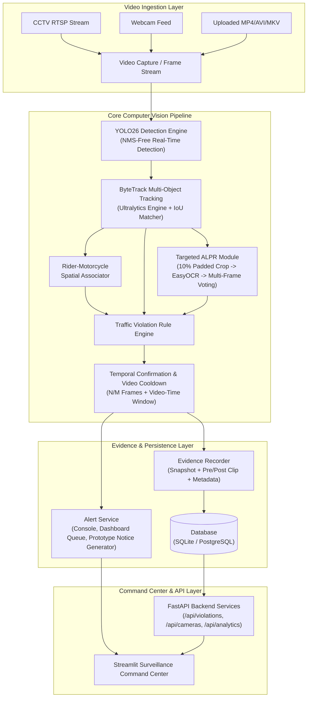

# AI-Driven Smart Traffic Violation Detection and Alert System

**B.Tech Design Project-I**  
**Lead AI Engineer & Full-Stack Developer:** Aatif Zafar  
**Deployment Profile:** Real-Time Traffic Surveillance & Violation Enforcement System (Research Prototype)

[](https://www.python.org/)
[](https://fastapi.tiangolo.com/)
[](https://streamlit.io/)
[](https://ultralytics.com/)
[](https://github.com/ifzhang/ByteTrack)
[](LICENSE)

---

## 1. Project Overview & Problem Statement

Urban traffic congestion, dangerous two-wheeler practices, signal jumping, and lane violations cause thousands of preventable road accidents daily in metropolitan cities across India (such as Bengaluru, Delhi, and Mumbai). Traditional manual enforcement by traffic police officers is physically constrained, susceptible to blind spots, and incapable of monitoring 24/7 high-density multi-lane junctions.

This project delivers a **production-structured, real-time AI computer vision system** designed to automate traffic violation monitoring from CCTV camera feeds, RTSP streams, and recorded dashcam footage. It integrates multi-object detection powered by the real-time NMS-free **YOLO26** architecture, persistent ByteTrack trajectory tracking, spatial rider-to-motorcycle association, Indian High-Security Registration Plate (HSRP) recognition, temporal violation confirmation, forensic evidence archiving, and an interactive traffic command center dashboard.

---

## 2. Core Features & Supported Violations

### Primary Violation Rules
1. **Riding Without Helmet (`NO_HELMET`):**
   - Head-crop spatial analysis of rider and pillion passengers.
   - Evaluated by the custom YOLO26 detector (`helmet` vs `no_helmet` box centre inside the top 35% of the rider box).
   - **Needs `models/traffic_custom.pt`.** Without it the rule stays off. The old edge heuristic flagged 23 of 23 helmet-wearing riders in testing, so it only runs if `violations.helmet_baseline: true` is set in `config.yaml` (demo use only).
   - Associated directly with tracked motorcycle entity.
2. **Triple Riding (`TRIPLE_RIDING`):**
   - Spatial association clusters multiple riders atop a single motorcycle.
   - Flags incidents when `rider_count > 2`.
3. **Red-Light Jumping (`RED_LIGHT_JUMP`):**
   - Dynamically configurable virtual stop-line vectors.
   - Intersection vector crossing detected while traffic signal phase is `RED`.
4. **Wrong-Way Driving (`WRONG_WAY`):**
   - Vehicle centroid trajectory vector smoothing across sliding windows.
   - Angular deviation calculation ($> 120^\circ$) against permitted lane vectors.
5. **Seatbelt and mobile-phone rules** exist in code but are **off** in `config.yaml` (no cabin camera or trained model yet). Future work.

### Key Capabilities
- **Temporal Confirmation:** Multi-frame confirmation ($N$ out of $M$ sliding frames) prevents single-frame false alarms.
- **Video Time Cooldown:** Video-synchronized cooldown ($frame\_idx / fps$) throttles duplicate penalty generation for the same vehicle track.
- **Indian HSRP ALPR:** Regex-based validation (`^[A-Z]{2}[0-9]{1,2}[A-Z]{0,3}[0-9]{4}$`), character ambiguity resolution (`0/O`, `8/B`, `1/I`), and multi-frame consensus voting.
- **Traceable Forensic Evidence:** Generates an incident folder with high-res snapshot (`violation_frame.jpg`), pre/post video clip (`evidence.mp4`), and audit payload (`metadata.json`).
- **Officer review first:** every detection is saved as *Waiting for review*. Only an officer's approval creates a prototype notice (not an official e-challan). Rejections keep their reason as training data.
- **Duplicate merging:** the same plate (or the same tracked vehicle) with the same violation within `dedup_window_seconds` becomes one record with a merged count.
- **Per-camera calibration:** stop line, lane direction, signal-light area and rule switches are set on the dashboard's Camera setup page and saved to `data/camera_calibration.yaml`. With signal mode `AUTO`, the red-light rule reads the lamp inside that area.

---

## 3. System Architecture



---

### Folder structure

Each folder has its own `README.md` that lists what is inside.

```
trafficdetection/
├── algorithms/            AI and computer-vision logic (one folder per algorithm)
│   ├── detection/         YOLO26n object detection            → detector.py
│   ├── tracking/          ByteTrack / DeepSORT tracking       → byte_tracker.py, deepsort_tracker.py
│   ├── association/       rider ↔ motorcycle linking          → rider_association.py
│   ├── plate_ocr/         EasyOCR number-plate reading        → plate_recognizer.py
│   ├── violation_rules/   helmet, triple riding, red light, wrong way (+ rule_engine.py)
│   └── calibration/       per-camera stop line / lane / signal colour → camera_calibration.py
├── pipeline/              runs the algorithms frame by frame  → traffic_pipeline.py, evidence_recorder.py
├── models/                trained weights: yolo26n.pt, traffic_custom.pt (after training)
├── training/              build the dataset + train the model (build_dataset.py, train_colab.ipynb …)
├── evaluation/            accuracy and speed (evaluate.py, benchmark.py, scenario_generator.py …)
├── datasets/              raw/ = Kaggle zips, merged/ = YOLO dataset built from them (not on GitHub)
├── backend/               FastAPI server
│   ├── api/               REST endpoints
│   ├── db_models/         database tables (SQLAlchemy)
│   ├── schemas/           API request/response formats
│   ├── services/          review workflow, alerts, notices
│   ├── database/          database connection + automatic schema update
│   └── config/            settings loaded from config.yaml / .env
├── dashboard/             Streamlit officer dashboard (app.py, ui.py, views/ = one file per page)
├── scripts/               everyday tools: run_video.py, seed_demo_data.py, clean_test_data.py
├── tests/                 unit tests (python -m pytest tests)
├── data/                  videos, evidence, local database, camera_calibration.yaml
├── docs/                  results, screenshots, research_papers/, project_documents/
└── config.yaml            all settings (models, thresholds, which rules are on)
```

---

## 4. Technology Stack

| Domain | Technology / Library | Role |
| :--- | :--- | :--- |
| **Language** | Python 3.11+ / 3.14 | Core runtime |
| **Deep Learning** | PyTorch & Ultralytics YOLO26 (`yolo26n.pt`) | Real-time NMS-free object detection |
| **Multi-Object Tracking** | ByteTrack (Ultralytics engine) | Persistent vehicle & rider tracking IDs |
| **ALPR & OCR** | EasyOCR, OpenCV, Regex | Indian plate recognition & multi-frame voting |
| **Backend API** | FastAPI, Uvicorn, Pydantic v2 | Async REST services & video ingestion |
| **Database & ORM** | SQLAlchemy ORM, SQLite / PostgreSQL | Structured persistence & event history |
| **Command Center** | Streamlit, Plotly, HTML5/CSS3 | Traffic monitoring dashboard & analytics |
| **Evidence Storage** | OpenCV VideoWriter, JSON | Forensic video clips and audit trails |

---

## 5. Installation & Environment Setup

### 1. Clone & Navigate to Repository
```bash
git clone <repository_url>
cd trafficdetection
```

### 2. Create Virtual Environment
**On Windows (PowerShell):**
```powershell
python -m venv .venv
.venv\Scripts\activate
```

**On Linux / macOS:**
```bash
python3 -m venv .venv
source .venv/bin/activate
```

### 3. Install Dependencies
```bash
pip install -r requirements.txt
```

---

## 6. Configuration & Environment Variables

Copy the example environment file:
```bash
cp .env.example .env
```

Review `config.yaml` to customize detection parameters, stop-line coordinates, and tracking settings:
```yaml
app:
  name: "AI-Driven Smart Traffic Violation Detection and Alert System"
  demo_mode: true
  device: "auto" # "cuda", "cpu", or "auto"

detection:
  model_traffic: "models/yolo26n.pt"
  model_custom: "models/traffic_custom.pt"
  confidence: 0.35
  iou: 0.45

tracking:
  algorithm: "bytetrack"

ocr:
  engine: "easyocr"
  plate_regex: "^[A-Z]{2}[0-9]{1,2}[A-Z]{0,3}[0-9]{4}$"

cameras:
  default_stop_line:
    x1: 150
    y1: 520
    x2: 1100
    y2: 520
```

---

## 7. Running the System

### Option A: Officer dashboard (Recommended)
```bash
pip install -r requirements.txt        # includes lap, needed by ByteTrack
streamlit run dashboard/app.py
```
Open `http://localhost:8501`. Pages: **Overview · Review queue · Live cameras · Upload proof · Violations · Vehicles · Analytics · Models · Evaluation · Camera setup · Settings**. Overview, Evaluation and Settings (and the demo scenarios, webcam/phone demo, confidence and high-sensitivity controls, incident inspector with fine schedule and notice download) are kept from the first dashboard version. Settings are saved to `data/app_settings.yaml`. **Live cameras** shows registered cameras only: filter by location, pick up to four, or add a camera. **Upload proof** lets a citizen upload a video or photo of a violation; videos are checked by the AI (helmet and triple riding) and every record goes to the review queue as a citizen report (files kept in `data/citizen_uploads/`).

Useful one-time commands:
```bash
python scripts/clean_test_data.py --apply     # remove rows that old test runs wrote into the real database
python scripts/seed_demo_data.py              # add clearly-marked DEMO records to show every page
python scripts/seed_demo_data.py --remove     # delete the demo records again
python -m pytest tests                        # tests use a temporary database, never data/traffic_system.db
```

### Option B: Launch FastAPI Backend Server
```bash
uvicorn backend.main:app --host 127.0.0.1 --port 8000 --reload
```
Interactive Swagger API documentation is available at `http://127.0.0.1:8000/docs`.

### Option C: Run End-to-End Pipeline on Sample Video
To generate a synthetic multi-violation traffic video and run the pipeline through OpenCV:
```bash
python evaluation/test_pipeline.py
```

### Option D: Run with Docker Compose (PostgreSQL + Microservices)
```bash
docker-compose up --build
```

---

## 8. API Endpoint Documentation

| Method | Endpoint | Description |
| :--- | :--- | :--- |
| `GET` | `/health` | System health check and runtime device status |
| `GET` | `/api/cameras` | List all configured camera feeds |
| `POST` | `/api/cameras` | Register a new camera or RTSP endpoint |
| `POST` | `/api/cameras/{id}/start` | Start stream ingestion for camera |
| `POST` | `/api/cameras/{id}/stop` | Stop stream ingestion for camera |
| `POST` | `/api/upload-video` | Upload video file and launch pipeline |
| `GET` | `/api/violations` | Searchable & filterable violation list |
| `GET` | `/api/violations/{id}` | Detailed incident record |
| `GET` | `/api/violations/{id}/evidence` | Forensic snapshots, video clips, and metadata |
| `GET` | `/api/vehicles/{plate_number}` | Vehicle history ledger by registration number |
| `GET` | `/api/analytics/summary` | Command center KPI metrics |
| `GET` | `/api/analytics/by-type` | Violations aggregated by category |
| `GET` | `/api/analytics/by-hour` | Hourly distribution profile |
| `GET` | `/api/analytics/hotspots` | Spatial violation cluster coordinates |
| `GET` | `/api/alerts/live` | Real-time incident alert feed |

---

### Running Traffic Pipeline on Video (CLI)
Run the end-to-end pipeline with stop-line and traffic signal state configuration:
```bash
python scripts/run_video.py --video data/videos/22.mp4 --signal AUTO
```
Outputs the annotated video, saved violation screenshots, and a terminal summary report.

### Benchmarking Hardware Inference Performance
Profiles average FPS, latency (mean, median, P95), and hardware utilization on YOLO26:
```bash
python evaluation/benchmark.py --frames 50 --size 640
```
Real benchmark results are saved to `data/benchmark_results.json` (Local CPU: ~23.9 FPS, ~39.1 ms latency).

### YOLOv8n vs YOLO26n

Review 1 planned YOLOv8; the project moved to YOLO26 (January 2026). Both are kept:

- **Models page:** a list of 13 models (YOLO26 n/s/m, YOLO11 n/s/m, YOLOv10 n/s, YOLOv8 n/s/m, YOLOv5 nu/su) with published accuracy and speed and an accuracy-vs-speed chart. Tick up to four, **compare** them on our own video (same frames, same pipeline), then press **Go live** on the one to use. Missing weights download automatically (needs internet). The live choice is saved in `data/app_settings.yaml`.
- **Live cameras:** *Detection model* picks the model for a run; *Compare side by side with* runs a second model on the same camera at once (practice run, nothing saved).
- **Evaluation page:** trained accuracy on our helmet/plate dataset for every model the Colab notebook trained, and speed benchmarks (`evaluation/benchmark.py --model all`).
- Command line: `python evaluation/compare_models.py --models yolo26n yolo11n yolov8n --video data/videos/traffic_junction_cctv.mp4`.

Published (Ultralytics, COCO, 640 px): YOLO26n 40.9 mAP50-95, 38.9 ms CPU, 2.4 M parameters; YOLOv8n 37.3 mAP50-95, 80.4 ms CPU, 3.2 M parameters.

### Model Training & Evaluation Results
Detailed training methodology, dataset distribution tables, Colab setup, and model evaluations are documented in:
👉 [docs/MODEL_RESULTS.md](docs/MODEL_RESULTS.md)

---

## 10. Research Context & Indian Driving Datasets

This system is architected for the unstructured dynamics of Indian traffic scenes:
- **India Driving Dataset (IDD):** 10,004 images across 34 classes capturing unstructured roadways, mixed vehicle density, and non-lane following behaviors.
- **DashCop & RideSafe-400:** Rider-motorcycle association frameworks and two-wheeler violation enforcement.
- **UFPR-ALPR:** Multi-frame redundancy for robust license plate identification under occlusions and variable lighting.

---

## 11. Limitations & Future Scope

### Current Limitations
- **Helmet model:** helmet detection needs the trained `models/traffic_custom.pt`; until it is added the helmet rule is off.
- **Camera Calibration:** stop line, lane direction and signal area are set by hand once per camera (Camera setup page).
- **Plate OCR speed:** EasyOCR on CPU is the slowest step; plates are read only for violators and every 8th frame per unread vehicle.
- **Severe Occlusion:** Heavy vehicle overlap in ultra-dense traffic can cause brief track fragmentation.
- **Cabin Glare:** Seatbelt detection requires clean windshield visibility; tinted or highly reflective glass impairs detection.

### Future Scope
- Automated stop-line and perspective vanishing point estimation.
- Edge TPU / NVIDIA Jetson Orin deployment optimization via TensorRT FP16 quantization.
- Direct integration with smart city traffic management centers (ITMS).
- Speed estimation using homography-calibrated bird's-eye-view transformations.

---

## 12. License
Licensed under the [MIT License](LICENSE).
